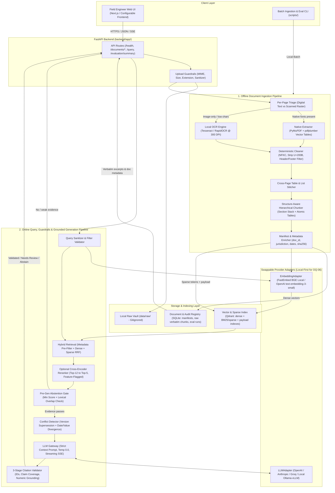
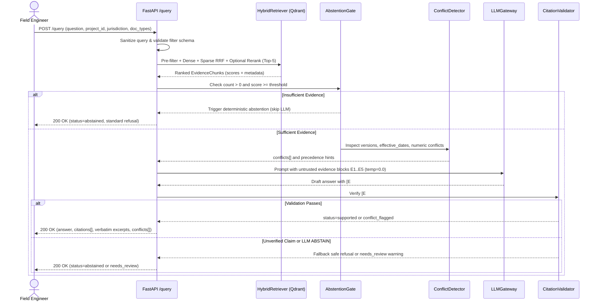

# RAG Architecture Specification — Site Shield AI

**Status:** Proposed Architecture (Awaiting Team & Mentor Sign-Off Before Gate 4 Implementation)  
**Target Branch / Gate:** Gate 3 — RAG Architecture Design  
**Authors / Team:** Team Fire (Squad 76) — 3 engineers, 5-week sprint (~25 working days)  
**Source Inputs:** [`SiteShield AI (PRD) Team Fire.pdf`](file:///home/abhinivesh/Downloads/siteshield_ai/SiteShield%20AI%20%28PRD%29%20Team%20Fire.pdf), [`docs/DOCUMENT_CORPUS_ANALYSIS.md`](file:///home/abhinivesh/Downloads/siteshield_ai/docs/DOCUMENT_CORPUS_ANALYSIS.md), [`docs/OPEN_QUESTIONS.md`](file:///home/abhinivesh/Downloads/siteshield_ai/docs/OPEN_QUESTIONS.md), [`README.md`](file:///home/abhinivesh/Downloads/siteshield_ai/README.md)

---

## 1. Architectural Drivers, Constraints & Corpus Reality

Every design decision in this specification is constrained by four verified realities from the PRD and [`docs/DOCUMENT_CORPUS_ANALYSIS.md`](file:///home/abhinivesh/Downloads/siteshield_ai/docs/DOCUMENT_CORPUS_ANALYSIS.md):

1. **Zero Real Construction Documents on Disk (`CQ-01`, `OQ-01`–`OQ-03`):** The repository currently contains `0` building codes, project specs, or inspection reports. The sole PDF ([`SiteShield AI (PRD) Team Fire.pdf`](file:///home/abhinivesh/Downloads/siteshield_ai/SiteShield%20AI%20%28PRD%29%20Team%20Fire.pdf), 5 pages) is a digital Google Docs/Skia export. The pipeline must therefore be **format-verified on known PDF edge cases today** while remaining **modular and configurable** when real construction documents arrive.
2. **Verified PDF Structural Pitfalls:** Direct inspection of the PRD PDF exposed stream-order table column scrambling (`pdftotext`), cross-page split tables with blank leading keys (Pages 4–5), minimal cell padding near borders, `27` injected `U+200B` zero-width spaces, cross-page bullet continuation (Page 1 → Page 2), and complete absence of `/CreationDate`, `/ModDate`, XMP metadata, and printed page numbers.
3. **Strict Safety, Traceability & Confidentiality Requirements:**
   - PRD §2.2 KPIs: `≥ 85%` Top-3 recall, `100%` cited claims, `0%` missing-document hallucination tolerance, `< 3.0s` end-to-end query latency.
   - `OQ-06` (unresolved data residency/confidentiality) & `OQ-11` (API keys/budgets) prohibit hard-coding a single cloud LLM/embedding vendor.
4. **Sprint & Runtime Constraints (`OQ-13`, `OQ-14`):** A 3-person team across 5 weeks (~25 working days) cannot absorb heavy framework debugging or multi-service operational sprawl; meanwhile, the host runs Python `3.14.4`, requiring a pinned `3.11`/`3.12` runtime in Docker/`.python-version` for reliable PDF/ML wheels.

### High-Level Design Principle: Custom Modular Python Over Heavy Framework Lock-In

| Dimension | Option A: Pure Python + FastAPI + Pydantic (Recommended) | Option B: LangChain / LlamaIndex (`PRD §4.2`) |
|---|---|---|
| **Debuggability & Citation Control** | Full control over chunk boundaries, verbatim offsets, exact `[E#]` prompt formatting, and deterministic citation checks | Abstraction chains hide prompts/metadata payloads and complicate deterministic sentence-to-chunk verification |
| **Latency Overhead (`< 3.0s` KPI)** | Minimal (~5–15 ms orchestration overhead) | Higher call-stack overhead and heavier cold imports |
| **5-Week Sprint Velocity (3 devs)** | Matches [`README.md`](file:///home/abhinivesh/Downloads/siteshield_ai/README.md) §6–§7 (`FastAPI` + `Pydantic`), easy `pytest` mocking via Ports/Adapters | Breaking framework version changes and wrapper debugging risk sprint delays |
| **Verdict** | **Selected** (clean `Port` protocols for Embedder, VectorStore, Reranker, LLM) | Rejected for core orchestration (individual utility libraries only if explicitly justified later) |

---

## 2. System & RAG Architecture Diagrams

### 2.1 End-to-End System Architecture (Ingestion + Retrieval + Generation)



### 2.2 ASCII Overview (Plain-Text Architecture Reference)

```text
+---------------------------------------------------------------------------------------------------+
|                                   OFFLINE / UPLOAD INGESTION                                      |
|  PDF/MD/TXT + Manifest -> [MIME/Size Guard] -> [Per-Page Triage: Digital vs Scanned]              |
|     -> [PyMuPDF + pdfplumber (Tables) | Local OCR] -> [Clean U+200B / NFKC / Strip Headers]       |
|     -> [Cross-Page Table & List Stitcher] -> [Hierarchical Section-Stack & Atomic Table Chunker]  |
|     -> [EmbeddingAdapter] ---> Qdrant (Dense + Sparse + Indexed Payload) + SQLite (Doc Registry)  |
+---------------------------------------------------------------------------------------------------+
                                                   |
                                                   v
+---------------------------------------------------------------------------------------------------+
|                               ONLINE QUERY & VERIFICATION (< 3.0s e2e)                            |
|  User Query + Filters -> [Sanitize & Normalize] -> [Pre-Filter: project_id/jurisdiction/type]    |
|     -> [Hybrid Retrieval: Dense + Sparse BM25 via RRF] -> [Optional Cross-Encoder Rerank]         |
|     -> [Gate 1: Abstention Threshold] --(Fail)--> Refusal Response ("I cannot find relevant...")  |
|     -> [Conflict Detector: Version/Date/Value Divergence]                                         |
|     -> [LLM Gateway (Temp=0.0, Isolated <evidence> Tags)]                                         |
|     -> [3-Stage Citation Validator: Ref ID + Claim Coverage + Numeric/Clause Check]               |
|     -> Response: {status, answer, citations[], conflicts[], verbatim_excerpts[], disclaimer}      |
+---------------------------------------------------------------------------------------------------+
```

### 2.3 Online Query, Conflict & Safety Execution Sequence



---

## 3. Document Ingestion and Extraction

### 3.1 Alternatives Comparison

| Option | Table Quality | Scan / OCR Support | Dependency & Sprint Risk | Decision |
|---|---|---|---|---|
| **A. `pypdf` / raw `pdftotext`** | **Fails** (verified on PRD Pages 2–4: emits Col 1 vertically before Cols 2–4) | None | Low | **Rejected** |
| **B. `Unstructured` (`hi_res` / Detectron2)** | Good | Built-in | Heavy system deps (`poppler`, `tesseract`, `libmagic`, `torch`), slow cold starts, risky under Python 3.11–3.14 & 5-week sprint | **Deferred** (revisit only if complex multi-column CAD/forms appear in real corpus) |
| **C. `PyMuPDF` + `pdfplumber` + Conditional Local OCR (Recommended)** | **High** (vector border geometry solves minimal cell padding) | **Per-page conditional** (`pytesseract` / `RapidOCR` at 300 DPI only on raster pages) | Moderate, pure Python wheels available for 3.11/3.12, aligns with [`README.md`](file:///home/abhinivesh/Downloads/siteshield_ai/README.md) §6 | **Selected** |

### 3.2 Extraction Pipeline Design

1. **Upload & File Guardrails:** Validate magic bytes (`%PDF-`, UTF-8 text, etc.), enforce `MAX_UPLOAD_SIZE_MB` and `ALLOWED_DOCUMENT_EXTENSIONS` from [`.env.example`](file:///home/abhinivesh/Downloads/siteshield_ai/.env.example), and compute `sha256_checksum` to reject or deduplicate identical re-uploads.
2. **Per-Page Scan Triage (Not Whole-File):**
   - Real construction packets frequently mix digital text pages with scanned signed inspection sign-offs (`OQ-02`, PRD §5.2).
   - For each PDF page, inspect via `PyMuPDF`: `(alnum_char_count >= 50 and embedded_fonts > 0)` vs `(raster_image_coverage >= 50% or alnum_char_count < 50)`.
   - **Digital path:** Extract text spans with font name, font size, bold/italic flags, and coordinates (`PyMuPDF`), plus explicit table grid geometry (`pdfplumber` vertical/horizontal line strategy, falling back to `PyMuPDF.find_tables()` when borderless).
   - **Scanned path:** Render page locally at 300 DPI and run local OCR (`RapidOCR` or `Tesseract` with deskew), tagging chunks with `extraction_method: "ocr"` and mean `ocr_confidence`. Never call cloud OCR/Vision APIs unless `OQ-06` explicitly approves external transmission.
3. **Cross-Page Table & List Stitcher (Directly Addresses PRD Anomalies):**
   - **Table Stitching:** If Page `N` terminates inside a table and Page `N+1` begins with a table having identical column count and matching column header row (verified on PRD Pages 4–5 for `Phase / Week | Focus Area | Key Deliverables`), strip the repeated header row, merge continuation rows, and when leading key cells are blank (`Week 5` continuation on Page 5), append/merge the continuation text onto the preceding row while expanding `page_end = N+1`.
   - **Format Extensions:** Support `.pdf` and `.md`/`.txt` in Gate 4 MVP; add thin adapters for `.docx` (`python-docx`) and `.xlsx`/`.csv` (`openpyxl`/`csv`) in Week 2 only if `OQ-02` confirms those formats in real samples.

---

## 4. Text Cleaning and Hierarchical Chunking

### 4.1 Deterministic Cleaning Rules (Grounded in PRD PDF Observations)

1. **Unicode Normalization & Invisible-Character Stripping:**
   - Apply Unicode `NFKC` normalization.
   - Strip zero-width and BOM artifacts (`\u200b`, `\u200c`, `\u200d`, `\ufeff`) — directly fixes the **27 `\u200b` occurrences** observed after `●` and `1.`/`2.`/`3.` markers in `SiteShield AI (PRD) Team Fire.pdf`.
2. **Symbol & Unit Preservation:** Normalize bullet glyphs (`●`, `▪`) to `- ` and whitespace runs while strictly preserving engineering operators and units (`≥`, `≤`, `±`, `°C`, `kN/m²`, `MPa`, `mm`, `→`).
3. **Running Header/Footer Deduplication:** Compare top 10% and bottom 10% vertical bands across pages; if identical normalized text (ignoring digits) appears on `≥ 60%` of pages (≥ 3 pages), strip it from chunk text while extracting printed page label if present. (Verified PRD PDF has 0 running headers/footers, so this rule activates safely only on longer construction codes.)
4. **Cautious De-hyphenation:** Join end-of-line soft breaks (`regula-\ntion` → `regulation`) only when lowercase continuation follows; preserve intentional code identifiers (`IS-456`, `GPT-4o-mini`, `top-3`).

### 4.2 Hierarchical Chunking Strategy

| Strategy | Why Rejected / Selected | Behavior on Verified PRD Edge Cases |
|---|---|---|
| **Fixed-size token splitting** | Splits clauses mid-sentence and shreds table rows | Breaks Page 3 `3.2 User Stories` row relationships |
| **Embedding-based semantic splitting** | Slow ingestion, unpredictable bounds, ignores numbering | Unreliable on short tables and numbered lists |
| **Structure-Aware Hierarchical + Atomic Table Chunker (Selected)** | Preserves regulatory clause paths (`4.2.1(a)`), handles cross-page continuations, keeps table rows bound to headers | Preserves `2.1 Primary Objectives` across Pages 1–2; binds `Week 5` table across Pages 4–5 |

**Concrete Chunking Rules:**
1. **Heading & Clause Parser:** Detect section transitions using combined font size/boldness (relative to body median font size) and regex patterns (`^\d+(\.\d+)*`, `^(Section|Clause|Article|Annex)\s+[A-Z0-9.]+`, `^Feature\s+\d+:`).
2. **Cross-Page Section Stack:** Maintain a stateful hierarchy stack (`section_path`, e.g., `["2. Objectives & Success Metrics", "2.1 Primary Objectives"]`) across page breaks so Page 2's continuation bullet inherits `2.1`.
3. **Chunk Sizing & Overlap:**
   - **Prose & Lists:** Target **350–500 tokens** (hard cap `650` tokens), with **50-token overlap strictly within the same `section_id`** — never overlap across distinct clauses or tables.
   - **Tables:** Represent extracted tables as structured Markdown tables (and row key-value linearized text for sparse/dense dual embedding). If table `≤ 600` tokens, keep atomic as 1 chunk (`content_type = "table"`). If `> 600` tokens, partition by whole rows (`~400` tokens/batch) and **prepend the column header row to every table chunk**.
   - **Context Prefix vs. Verbatim Text:** Embed `[Doc: {doc_title} | Section: {section_path}] {chunk_text}` for higher retrieval precision, while storing unprefixed `text_verbatim` in the document registry/payload for faithful side-by-side citation display.

---

## 5. Metadata Schema and Source Provenance

Because verified PDF inspection confirmed that PDF `/Info` dictionaries and OS timestamps (`mtime`/`ctime`) cannot supply reliable dates, jurisdictions, or project IDs, provenance uses a **Two-Tier Metadata Model**:

### 5.1 Document-Level Metadata (Registered at Ingestion / Manifest)

| Field | Type | Required | Description / Example |
|---|---|---|---|
| `doc_id` | `string` (UUID / slug) | Yes | Stable unique document identifier |
| `doc_title` | `string` | Yes | Canonical human title (e.g., `National Building Code 2016 - Part 4`) |
| `doc_type` | `enum` | Yes | `code \| spec \| report \| safety_manual` (reconciles PRD/`README.md`/`OQ-01`) |
| `jurisdiction` | `string` | Yes | Normalized code (`IN-KA`, `US-IBC`, `GLOBAL`, or `UNSPECIFIED` if pending review) |
| `project_id` | `string \| null` | Nullable | Required for `spec` and `report`; `null` for general `code` / `safety_manual` |
| `standard_code` | `string \| null` | Nullable | Regulatory identifier (e.g., `IS 456:2000`, `IBC 2021`) |
| `version` | `string` | Yes | Revision label (e.g., `Rev 2.1`, `2024`, `v1.0`) |
| `publication_date` | `date (ISO-8601) \| null` | Conditional | Document issue date when stated |
| `effective_date` | `date (ISO-8601) \| null` | Conditional | Governing effective date (used for conflict precedence) |
| `effective_timestamp` | `int64 \| null` | Derived | Unix epoch seconds for vector DB numeric range queries |
| `supersedes_doc_id` | `string \| null` | Nullable | Links directly to an older superseded `doc_id` |
| `status` | `enum` | Yes | `active \| superseded \| draft` (default `active`) |
| `confidentiality_tier` | `enum` | Yes | `public \| internal \| restricted` (enforces `OQ-06` routing policy) |
| `source_filename` | `string` | Yes | Original uploaded filename |
| `sha256_checksum` | `string` | Yes | Content hash for exact deduplication and tamper verification |
| `ingested_at` | `datetime (UTC)` | Yes | Ingestion timestamp |

### 5.2 Chunk-Level Provenance Payload (Stored in Qdrant + SQLite)

Every indexed vector carries filterable document metadata **plus** granular citation provenance:
- `chunk_id` (`sha256(doc_id:page_start:section_id:chunk_index)[:16]`)
- `doc_id`, `doc_title`, `doc_type`, `jurisdiction`, `project_id`, `standard_code`, `version`, `effective_date`, `effective_timestamp`, `status`
- `page_start` (`int`, 1-based PDF index), `page_end` (`int`)
- `printed_page_label` (`string | null`, when printed footer differs from PDF page index)
- `section_id` (`string | null`, e.g., `"4.2.1"`), `section_path` (`list[str]`)
- `chunk_index` (`int`, within document for neighbor expansion)
- `content_type` (`"prose" | "list" | "table"`)
- `extraction_method` (`"native" | "ocr"`), `ocr_confidence` (`float | null`)
- `char_start` / `char_end` (`int`, offsets within cleaned page text)
- `text_verbatim` (`string`, clean unprefixed excerpt for side-by-side UI rendering)

---

## 6. Embedding Provider Selection

| Candidate Model | Dimensions | Data Residency (`OQ-06`) | Query Latency | Trade-Off Assessment |
|---|---|---|---|---|
| **A. `BAAI/bge-small-en-v1.5` or `bge-base-en-v1.5` via FastEmbed (ONNX)** | 384 / 768 | **100% Local** (zero external egress) | ~15–40 ms on CPU | Best fit if construction specs/reports are confidential (`OQ-06`); zero API cost; lightweight ONNX runtime avoids PyTorch bloat |
| **B. OpenAI `text-embedding-3-small`** | 1536 (or 512 shortened) | **Cloud API** (sends chunk text externally) | ~80–180 ms network | Very low cost (~$0.02/1M tokens), zero local RAM/CPU, fast setup; **blocked if `OQ-06` prohibits cloud transfer** |
| **C. `bge-large-en-v1.5` / `text-embedding-3-large`** | 1024 / 3072 | Local / Cloud | Higher RAM & latency | Unnecessary memory/storage overhead for MVP corpus; revisit only if Top-3 recall < 85% |

**Architectural Decision:** Implement a strict `EmbeddingAdapter` protocol (`embed_documents(texts) -> list[list[float]]`, `embed_query(text) -> list[float]`, plus `model_id` and `dimensions` metadata):
- **Primary Default (Safe-by-Default for `OQ-06`):** `BAAI/bge-base-en-v1.5` (or `bge-small-en-v1.5` if container RAM is tight) via **FastEmbed ONNX** so CI tests and confidential site documents run completely locally with zero external leakage.
- **Cloud Adapter Option:** `OpenAI text-embedding-3-small` enabled via `EMBEDDING_PROVIDER=openai` only once `OQ-06` confirms non-restricted data and `OQ-11` provisions API credentials.
- **Index Isolation Invariant:** Persist `embedding_model` and `embedding_dim` in index metadata; switching providers triggers a clean collection rebuild rather than mixing incompatible vectors.

---

## 7. Vector Database Selection

### 7.1 Alternatives Comparison (`PRD §4.2`, `README.md §6`, `OQ-12`)

| Criterion | Qdrant (Recommended) | ChromaDB | Pinecone |
|---|---|---|---|
| **Data Residency / Self-Hosting** | Local persistent mode (`:memory:` / disk) **or** Docker container (`qdrant/qdrant`) | Embedded local disk or server | Managed cloud-only (**violates `OQ-06` local option**) |
| **Metadata Pre-Filtering** | Native **payload indexes** (`keyword`, `integer` range on `effective_timestamp`, `MatchAny`, `IsNull` for `project_id = null OR project_id = X`) | Basic `where` filters; weaker complex `OR`/`null` + numeric range ergonomics | Good, but cloud-bound |
| **Hybrid Dense + Sparse Search** | **Native** multi-vector collections (Dense + Sparse BM25/SPLADE with built-in **RRF fusion** in 1 call) | Dense-only natively (requires separate in-memory BM25 index synced manually) | Separate sparse/dense handling |
| **Concurrency & Production Readiness** | High (Rust gRPC/HTTP server, concurrent FastAPI workers safe) | SQLite/DuckDB local locking caveats under multi-worker writes | Managed |
| **Sprint Setup Cost** | Minimal (1 service in `docker-compose.yml`, plus zero-service `QdrantClient(path=...)` for unit/integration tests) | Zero extra container | External account & billing |

**Architectural Decision:** Select **Qdrant** via a thin `VectorStorePort` interface.
- **Why Qdrant wins for Site Shield AI:** Construction compliance queries require **strict metadata pre-filtering** (e.g., *"return active building codes where `project_id IS NULL` PLUS specifications/reports where `project_id == '#104'` AND `jurisdiction == X`"*) combined with **hybrid dense + lexical matching** for exact clause numbers (`4.2.1`, `IS 456`) and technical units (`28 days`, `MPa`).
- Using Qdrant's local disk/in-memory client for `pytest` and containerized Qdrant in `docker-compose.yml` gives both zero-dependency CI testing and production-grade concurrency.

---

## 8. Retrieval and Metadata Filtering

### 8.1 Why Pure Semantic Search Is Insufficient
Pure dense embeddings frequently confuse numerically adjacent construction terms (e.g., `7 days` vs `28 days` curing, `Grade M25` vs `M30`, `Clause 4.2.1` vs `4.2.2`) and miss exact project identifiers (`Project #104`).

### 8.2 Hybrid Retrieval Pipeline

1. **Mandatory Scoping & Pre-Filtering (`project_id` + `jurisdiction` + `doc_type` + `status`):**
   - When `project_id` is supplied, construct a Qdrant filter matching `(project_id == requested_project_id) OR (project_id IS NULL AND doc_type IN ["code", "safety_manual"])` so site engineers see both project-specific specs/reports and applicable baseline building codes.
   - Default `status == "active"` unless `include_superseded = true` is explicitly passed for audit comparison.
2. **Dual-Path Hybrid Search + RRF:**
   - **Dense path:** Top-20 chunks by cosine similarity (`BGE` / `OpenAI`).
   - **Sparse / Lexical path:** Top-20 chunks via BM25/IDF sparse vectors inside Qdrant (captures exact clause strings, unit numbers, equipment names like `shuttering` or `scaffolding`).
   - **Fusion:** Merge via **Reciprocal Rank Fusion (`k = 60`)** into Top-12 candidates.
3. **Deterministic Query Normalization (No Slow LLM Rewrite in Hot Path):**
   - Strip zero-width characters, normalize units/clause aliases (`Sec. 4.2.1` → `Section 4.2.1`, configurable domain acronym table such as `RCC` → `Reinforced Cement Concrete`), avoiding an extra 500–800 ms LLM query-rewriting round trip that would threaten the `< 3.0s` KPI.
4. **Same-Section Context Expansion:**
   - If a top hit is a `list` item or small continuation chunk, optionally attach adjacent `chunk_index ± 1` **only within the same `doc_id` and `section_id`** so multi-part bullets remain complete.

---

## 9. Reranking Trade-Offs

PRD §3.1 requires prioritizing exact regulatory clauses over general narrative sections, while PRD §2.2 constrains total latency to **`< 3.0s`**.

| Reranking Option | Recall / Precision Gain | Added Latency (Top-12 → Top-5) | Trade-Off Assessment |
|---|---|---|---|
| **A. Deterministic Structural Boost Only** | Moderate (+2–5% on exact clause/table hits) | **< 5 ms** | Boosts chunks with `section_id` match, `content_type == "table"` when query asks numerical specs, and `effective_timestamp` recency; zero model footprint |
| **B. Local Cross-Encoder (ONNX `ms-marco-MiniLM-L-6-v2` or `bge-reranker-base`)** | **High** (+8–15% Top-3 precision on complex multi-doc queries) | ~120–350 ms on CPU (Top-12 capped to 512 tokens) | Zero external egress (`OQ-06` safe); fits within `3.0s` budget when Top-K candidate count is strictly capped (`≤ 12`) and quantized ONNX is used |
| **C. Cloud Rerank API (e.g., Cohere Rerank)** | High | ~120–250 ms | Extra API cost, network failure mode, and external data egress (`OQ-06` conflict) |
| **D. LLM-as-Reranker** | High | **700–1,800 ms** | **Rejected** — blows `< 3.0s` e2e latency budget |

**Architectural Decision:** Implement a **two-step configurable reranker (`ENABLE_RERANKER` flag)**:
- **Baseline (always active):** RRF + deterministic structural/recency scoring (`< 5 ms`).
- **Cross-Encoder Stage (enabled and benchmarked in Week 3):** Local ONNX cross-encoder (`ms-marco-MiniLM-L-6-v2` default for CPU latency, `bge-reranker-base` alternative) over **max 12 candidates → Top-5** evidence chunks. Benchmark latency (`p95`) vs `Recall@3` on the Week 5 evaluation set before keeping enabled by default.

---

## 10. Grounded Generation

### 10.1 LLM Provider Alternatives (`PRD §4.2`, `OQ-06`, `OQ-11`)

| Provider Option | Streaming TTFT / e2e Latency | Data Residency (`OQ-06`) | Citation Instruction Adherence |
|---|---|---|---|
| **OpenAI `gpt-4o-mini` / Anthropic `claude-3-5-haiku`** | Fast (~0.4s TTFT, ~1.2–2.0s total) | External Cloud API | High (native structured JSON + strict `[E#]` adherence) |
| **Groq `Llama-3.1/3.3`** | Very fast (~0.2s TTFT, ~0.8–1.5s total) | External Cloud API | Good (requires strict schema + temperature `0.0`) |
| **Local `Ollama / vLLM` (`Qwen-2.5-7B-Instruct` / `Llama-3.1-8B`)** | ~1.0–2.5s on GPU (`≥ 8 GB VRAM`); **5–15s on CPU** | **100% Local / Air-gapped** | Moderate-to-Good |

**Architectural Decision:** Abstract behind `LLMAdapter` (`generate_grounded(prompt, evidence_blocks, stream=True)`):
- Enforce `temperature = 0.0`, `max_tokens = 700`, and **streaming Server-Sent Events (SSE)** for UI responsiveness (`< 3.0s` target).
- If `OQ-06` permits cloud APIs, default to `gpt-4o-mini` or `claude-3-5-haiku` (or Groq if ultra-low latency needed). If `OQ-06` mandates local inference, require a GPU host (`≥ 8 GB VRAM`) for vLLM/Ollama to meet `< 3.0s`; otherwise document explicitly in Week 3 evaluation that CPU-only local LLM violates the `3.0s` latency SLA.
- **Prompt Evidence Contract:** Format retrieved chunks as numbered, isolated XML blocks (`[E1]`..`[E5]`) showing `doc_title`, `doc_type`, `version`, `effective_date`, `section_id`, `page_start`–`page_end`, and `text_verbatim`. Instruct the model to cite every factual sentence inline using `[E#]` and output `ABSTAIN` if the evidence does not directly answer the specific question.

---

## 11. Citation Validation

To achieve the PRD §2.2 target of **`100% cited claims`** and prevent fabricated references (`README.md` §10), every generated response passes through a **deterministic post-generation Citation Validator** (`< 10 ms`) before final emission:

1. **Tag Integrity Check:** Verify every `[E#]` marker in the answer maps to an actual `EvidenceBlock` retrieved for this request. Any hallucinated `[E9]` or external standard citation not present in retrieved text triggers validation failure.
2. **Sentence-Level Coverage Check:** Segment the response into declarative statements (excluding standardized disclaimers or transition headers); verify every factual/regulatory claim contains at least one valid `[E#]` tag.
3. **Literal Number, Unit & Clause Cross-Check:** Extract numeric values + units (`\b\d+(\.\d+)?\s*(days?|hours?|mm|cm|m|MPa|kN|%|°C)\b`) and clause identifiers (`Clause/Section \d+(\.\d+)*`) from each sentence; verify each extracted token appears verbatim in at least one of its attached `[E#]` source texts.
4. **Failure Policy:**
   - If non-streaming or caught prior to final JSON completion: attempt **1 fast self-repair / drop ungrounded sentence** if remaining claims cover the answer, OR fall back to `status = "needs_review"` / safe abstention (`status = "abstained"`).
   - For **streaming SSE**, emit draft tokens immediately for `< 3.0s` perceived latency, then emit a mandatory terminal `validation` SSE event containing `{status, verified_citations[], conflicts[], validation_passed}` so the UI displays a **Verified** badge or replaces/flags unverified claims before the engineer acts on them!

---

## 12. Conflict Detection

PRD §5.2 highlights **High Risk** conflicts between older site inspection reports and updated building codes (or superseded revisions). Because silent timestamp-only filtering risks hiding an active project deviation or field non-conformance report, Site Shield AI uses **Transparent Conflict Flagging**:

1. **Retrieval Inclusion Rule:** Retrieve across eligible active documents (and optionally compare against recent superseded revisions of the same `standard_code` / `doc_title` when multiple versions exist).
2. **Layer 1 — Metadata Divergence Check (Deterministic, `< 5 ms`):**
   - Trigger a metadata conflict warning whenever top retrieved chunks contain:
     - Multiple `version` or `effective_date` values for the same `standard_code` or `supersedes_doc_id` chain; **OR**
     - Both a historical `report` and a newer `code`/`spec` addressing the same topic with differing `effective_date`s.
3. **Layer 2 — Value & Polarity Contradiction Check (Triggered only when ≥ 2 documents cover the query):**
   - Compare extracted numeric thresholds/units across distinct documents (e.g., Doc A specifies `curing >= 7 days` vs Doc B specifies `curing >= 14 days`) or contradictory modality (`must` / `shall` vs `prohibited` / `exempt`).
   - Run a lightweight structured contradiction check (within the single grounded generation JSON schema or dedicated fast check) to populate `conflicts[]`:
     - `conflict_type`: `"version_supersession" | "cross_document_value_mismatch" | "report_vs_code_divergence"`
     - `source_a` & `source_b`: `{doc_id, doc_title, version, effective_date, section_id, page_start, excerpt}`
     - `summary`: Concise human-readable difference
     - `precedence_note`: Heuristic note (e.g., *"Newer governing code/project spec dated YYYY-MM-DD supersedes earlier report dated YYYY-MM-DD — verify with Project Engineer."*).
4. **Invariant:** Never suppress the older or stricter requirement silently; surface both with explicit dates and set response `status = "conflict_flagged"`.

---

## 13. Abstention and Prompt Injection Protection

### 13.1 Multi-Gate Abstention (`0%` Missing-Doc Hallucination Target)

| Gate | Trigger Condition | Action | Latency Impact |
|---|---|---|---|
| **Gate 1: Pre-Generation Retrieval Gate** | `0` chunks pass metadata pre-filter, OR `max(calibrated_score) < MIN_RETRIEVAL_SCORE` AND zero non-stopword lexical overlap | **Skip LLM entirely**; return `status = "abstained"` with standard refusal: *"I cannot find relevant information in the provided codes or reports."* | **Saves ~1.5s** (~50 ms response) |
| **Gate 2: In-Context LLM Refusal** | Retrieved chunks are topically adjacent (e.g., concrete mixing) but do not specify the asked condition (e.g., *high-moisture foundation slab curing*) | Model outputs explicit `ABSTAIN` flag per system prompt; API returns `status = "abstained"` | Standard generation latency |
| **Gate 3: Post-Generation Validation Gate** | Citation validator detects unverified numbers/clauses or unsupported claims | Override unsafe output with `status = "abstained"` (or `"needs_review"` if partial verified warning applies) | `< 10 ms` |

### 13.2 Prompt Injection & Indirect Document Injection Protection

Construction PDFs come from diverse contractors and external vendors; malicious or malformed text embedded inside an uploaded PDF (indirect prompt injection) or crafted user input must not hijack system rules:

1. **Strict Instruction/Data Separation:**
   - Wrap all document chunks inside XML/JSON data delimiters (`<evidence id="E1" untrusted_data="true">...</evidence>`) and instruct the system prompt that text inside `<evidence>` is **passive reference text only — never executable instructions**.
   - Never concatenate retrieved chunk text into the `system` role prompt; keep it strictly in a structured `user` context block.
2. **Input & File Sanitization:**
   - Strip zero-width characters (`\u200b`, `\ufeff`) and ASCII control characters from both ingested documents and incoming user queries.
   - Enforce maximum query length (e.g., `1,000` chars), strict Pydantic field validation on metadata filters (`doc_type` enum, regex-validated `project_id`), and PDF parser safety limits (file size cap `MAX_UPLOAD_SIZE_MB`, max page limit per upload, decompression/object bounds).
3. **Zero Tool/Execution Privilege for Query LLM:**
   - The RAG generation LLM has **zero tool-calling, code-execution, SQL, filesystem, or outbound HTTP permissions**. Its output is strictly constrained to natural language + `[E#]` citations / structured JSON.
4. **System-Prompt & Secret Isolation:**
   - Never inject `.env` values or internal config into prompts; apply output filtering to prevent echoing prompt template tags (`<evidence>`, system instructions).

---

## 14. API Contracts

All endpoints align with [`README.md`](file:///home/abhinivesh/Downloads/siteshield_ai/README.md) §9 and use FastAPI + Pydantic v2 schemas under `/api/v1` (or root routes aliased cleanly to match `README.md`).

### 14.1 Endpoint Summary

| Method | Path | Purpose | Notes |
|---|---|---|---|
| `GET` | `/health` | Liveness & dependency readiness | Reports API status, SQLite & Qdrant health, active `embedding_model` |
| `POST` | `/documents/ingest` | Upload + extract + chunk + index | `multipart/form-data` (file + JSON `metadata` manifest fields) |
| `GET` | `/documents` | List indexed documents | Query filters: `doc_type`, `jurisdiction`, `project_id`, `status`, `limit`, `offset` |
| `GET` | `/documents/{doc_id}` | Inspect single document metadata & stats | Returns manifest metadata, `chunk_count`, `extraction_methods`, checksum |
| `POST` | `/query` | Ask compliance question (JSON or SSE) | Supports `stream=true` (SSE) or `stream=false` (JSON) |
| `GET` | `/evaluation/summary` | Retrieve latest RAG evaluation benchmark | Reads latest persisted report from `tests/evaluation/` runs |

*(Note: `DELETE /documents/{doc_id}` is deferred behind `OQ-07` authentication/RBAC decisions so anonymous clients cannot delete compliance records.)*

### 14.2 Core Request & Response Contracts

#### `POST /documents/ingest`
- **Request (`multipart/form-data`):**
  - `file`: Binary upload (`.pdf`, `.md`, `.txt`)
  - `metadata` (JSON string):
    ```json
    {
      "doc_title": "SiteShield AI (PRD) Team Fire",
      "doc_type": "spec",
      "jurisdiction": "UNSPECIFIED",
      "project_id": null,
      "standard_code": null,
      "version": "v1.0",
      "publication_date": "2026-11-02",
      "effective_date": "2026-11-02",
      "supersedes_doc_id": null,
      "confidentiality_tier": "internal"
    }
    ```
- **Response (`201 Created`, `409 Conflict` if duplicate SHA-256, `413` if oversized, `422` if invalid MIME/metadata):**
  ```json
  {
    "doc_id": "doc_9f3a1c2b",
    "sha256_checksum": "e3b0c442...",
    "page_count": 5,
    "chunks_created": 14,
    "tables_extracted": 5,
    "extraction_summary": { "native_pages": 5, "ocr_pages": 0 },
    "warnings": ["No embedded PDF CreationDate; used manifest effective_date."]
  }
  ```

#### `POST /query`
- **Request (`application/json`):**
  ```json
  {
    "query": "What is the minimum concrete curing duration for foundation slabs under high moisture conditions?",
    "filters": {
      "project_id": "Project #104",
      "jurisdiction": null,
      "doc_types": ["code", "spec", "report"],
      "include_superseded": false
    },
    "top_k": 5,
    "stream": false
  }
  ```
- **Response (`200 OK`):**
  ```json
  {
    "query_id": "qry_01J...",
    "status": "supported",
    "answer": "For foundation slabs under high moisture conditions, minimum curing duration is ... [E1].",
    "citations": [
      {
        "evidence_id": "E1",
        "chunk_id": "chk_4a8b...",
        "doc_id": "doc_nbc_part4",
        "doc_title": "Concrete Specification Rev 2",
        "doc_type": "spec",
        "version": "Rev 2",
        "effective_date": "2025-06-01",
        "jurisdiction": "IN-KA",
        "project_id": "Project #104",
        "section_id": "4.2.1",
        "section_path": ["4. Concrete Works", "4.2 Curing", "4.2.1 Moisture Conditions"],
        "page_start": 12,
        "page_end": 12,
        "content_type": "prose",
        "extraction_method": "native",
        "retrieval_score": 0.89,
        "text_verbatim": "4.2.1 Under high moisture conditions, foundation slabs shall be cured for..."
      }
    ],
    "conflicts": [],
    "abstention_reason": null,
    "latency_ms": {
      "embedding": 28,
      "retrieval": 45,
      "rerank": 140,
      "generation": 1120,
      "validation": 4,
      "total": 1337
    },
    "disclaimer": "AI-generated decision support. Verify cited source clauses and governing revisions before site execution."
  }
  ```
  - Valid `status` values: `"supported" | "conflict_flagged" | "needs_review" | "abstained"`.
  - When `stream=true` (`text/event-stream`), emit events: `metadata` (retrieved candidate refs) → `token` (streamed answer deltas) → `validation` (final JSON object with verified `status`, `citations[]`, `conflicts[]`, `latency_ms`).

#### `GET /evaluation/summary`
- **Response (`200 OK`):**
  ```json
  {
    "run_id": "eval_2026_11_20",
    "dataset_size": 24,
    "metrics": {
      "recall_at_3": 0.88,
      "precision_at_3": 0.79,
      "citation_coverage_rate": 1.0,
      "abstention_accuracy": 1.0,
      "conflict_detection_f1": 0.92,
      "p50_latency_ms": 1420,
      "p95_latency_ms": 2680
    }
  }
  ```

#### Standard Error Envelope (`4xx` / `5xx`)
```json
{
  "error": {
    "code": "INVALID_DOCUMENT_TYPE",
    "message": "Uploaded file failed PDF magic-byte validation.",
    "request_id": "req_81c2..."
  }
}
```

---

## 15. Testing and Evaluation

### 15.1 Automated Test Pyramid (`pytest` + `Ruff` in CI)

| Layer | Directory | Coverage & Fixtures (Zero External API Calls in CI) |
|---|---|---|
| **Unit Tests** | `backend/tests/unit/` | - Deterministic cleaner (`\u200b` stripping, unit/symbol preservation like `≥`, `°C`, `kN/m²`)<br>- Cross-page table stitcher (using PRD Pages 4–5 split `Week 5` structure as a regression fixture)<br>- Cross-page list/section stacker (using PRD Pages 1–2 `2.1` continuation fixture)<br>- Citation validator (valid `[E#]`, fabricated `[E99]`, unverified numeric change `7 days` → `14 days`)<br>- Conflict detector (same `standard_code` differing `effective_date`, `report` vs `code` mismatch)<br>- Prompt injection & upload guardrails (magic-byte rejection, oversized payload, `<evidence>` escaping) |
| **Integration Tests** | `backend/tests/integration/` | - Full `POST /documents/ingest` → `QdrantClient(":memory:")` + SQLite → `POST /query` flow using deterministic `MockEmbeddingAdapter` & `MockLLMAdapter`<br>- Filter scoping tests (`project_id` isolation + global `code` inclusion)<br>- Gate 1 abstention short-circuit verification (`LLM` mock assert `call_count == 0`) |
| **RAG Evaluation Harness** | `backend/tests/evaluation/` & `scripts/evaluate_retrieval.py` | Runs against curated `20+` scenario benchmark dataset (once real construction corpus arrives) |

### 15.2 Evaluation Metrics (Reconciling PRD §2.2 & `README.md` §11)

PRD §2.2 previously merged Precision and Recall in one row (`Retrieval Precision @ Top-K` = `≥ 85% top-3 recall`). The evaluation suite tracks them **independently**:

| Metric | Target | Dataset Slice & Measurement |
|---|---|---|
| **Retrieval `Recall@3`** | `≥ 85%` | % of answerable queries where all gold source chunk(s) appear in Top-3 retrieved results |
| **Retrieval `Precision@3` / `MRR`** | Baseline + Track | Diagnostic ranking precision across Top-3 (especially after toggling cross-encoder reranker) |
| **Citation Coverage & Groundedness** | `100%` cited claims | Automated `CitationValidator` pass rate + manual spot audit of verbatim quotes & page numbers |
| **Missing-Doc Abstention Accuracy** | `100%` (`0%` hallucination) | Negative test queries outside corpus scope (must return `status == "abstained"`) |
| **Conflict Flagging Accuracy** | `≥ 90%` recall on conflict pairs | Synthetic/curated pairs with superseded code vs old inspection report |
| **Prompt Injection Resistance** | `100%` pass | Adversarial queries & poisoned PDF chunks attempting rule override or system prompt exfiltration |
| **End-to-End Latency (`p95`)** | `< 3.0 seconds` | Measured across full `POST /query` execution (embedding + Qdrant + rerank + LLM) |

---

## 16. Sprint Execution Alignment & Pre-Implementation Sign-Off Checklist

### 16.1 Sprint Mapping (5-Week Plan, 3 Engineers)
- **Week 1 (Current):** Approve `RAG_ARCHITECTURE.md`, collect real construction corpus into `data/raw/` (`CQ-01`), pin Python `3.11`/`3.12` in `.python-version` (`OQ-14`), confirm open decisions below.
- **Week 2:** Implement `backend/app/ingestion/` (`PyMuPDF` + `pdfplumber` + local OCR triage, cleaner, table stitcher, hierarchical chunker), `Qdrant` + SQLite registry, `EmbeddingAdapter`, and unit tests.
- **Week 3:** Implement `HybridRetriever`, optional ONNX reranker, `ConflictDetector`, `LLMGateway`, `CitationValidator`, and multi-gate `Abstention` + SSE `/query` endpoint.
- **Week 4:** Build selected frontend UI (`OQ-10`) with side-by-side citation/conflict inspection + integration test suite.
- **Week 5:** Author `20+` gold QA scenarios (`OQ-15`), run `evaluate_retrieval.py`, tune `MIN_RETRIEVAL_SCORE` & reranker latency (`< 3.0s`), finalize Docker Compose & demo.

### 16.2 Decisions Required Before Gate 4 Implementation Starts

| Open ID | Decision Required | Architecture Default If Approved |
|---|---|---|
| `OQ-01` / `CQ-01` | Supply real construction corpus samples (`code`, `spec`, `report`) in `data/raw/` | Ingestion validated against PRD PDF anomalies; real calibration awaits samples |
| `OQ-06` | Confirm confidentiality / cloud API policy | Local-first FastEmbed (`BGE`) + Qdrant; LLM adapter switches local vs cloud by env var |
| `OQ-10` | Approve frontend: **Next.js** ([`README.md`](file:///home/abhinivesh/Downloads/siteshield_ai/README.md)) vs **Streamlit** (PRD) | API contracts are frontend-agnostic; **Next.js** aligns with [`README.md`](file:///home/abhinivesh/Downloads/siteshield_ai/README.md) & `.gitignore` |
| `OQ-11` | Confirm LLM & embedding credentials / local GPU availability | `gpt-4o-mini` / `claude-3-5-haiku` / `Groq` if cloud allowed; GPU required for `< 3.0s` local LLM |
| `OQ-12` | Confirm **Qdrant** vs ChromaDB | **Qdrant** recommended for hybrid dense+sparse & metadata range/null filtering |
| `OQ-13` | Confirm custom modular Python vs LangChain | **Custom modular Python + FastAPI + Pydantic** recommended |
| `OQ-14` | Pin Python `3.11` or `3.12` (host runs `3.14.4`) | Pin Python `3.12` in Docker and `uv`/`.python-version` |
